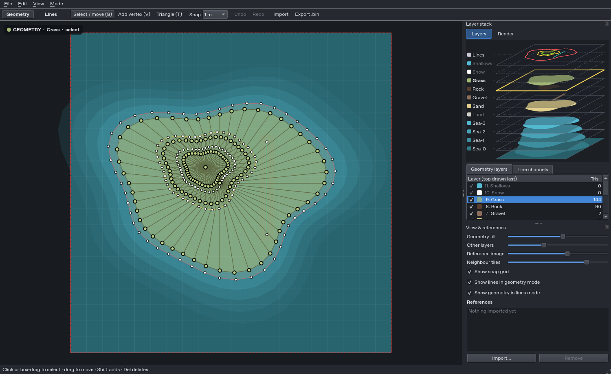

# Buckshot 3

A desktop editor for modding Stormworks map tiles. Render the game's `.mesh` files into a top-down
reference image, generate shoreline and height contour lines from them, edit the tile's geometry and
map lines by hand, and export a ready-to-use map `.bin`, all in one window with no intermediate files.
Map files are read and written with [sw_ducky](https://github.com/lganic/SW-Ducky).



*The running editor with a synthetic demo island, showing geometry editing, map lines, and the layer stack.*

## Requirements

* **Python 3.10 or newer.** Get it from [python.org](https://www.python.org/downloads/).
  On Windows, tick **"Add python.exe to PATH"** in the installer.
* Three Python libraries: **PySide6** (the GUI), **numpy** and **sw_ducky**. They're listed in
  `requirements.txt` and installed in step 2 below.

The commands below are for Windows, where Python installs the `py` launcher.
On macOS or Linux, use `python3` wherever you see `py`.

## Install

### 1. Download Buckshot 3

Either clone it with git:

```
git clone https://github.com/lganic/SW-Buckshot3.git
cd SW-Buckshot3
```

or, without git, go to the [GitHub page](https://github.com/lganic/SW-Buckshot3), click **Code → Download ZIP**,
extract it, and open a terminal in the extracted folder (the one containing `README.md`).

### 2. Install the libraries

From inside the Buckshot 3 folder:

```
py -m pip install -r requirements.txt
```

This pulls PySide6 and numpy from PyPI, and sw_ducky straight from its GitHub repository
(it isn't on PyPI, and git isn't needed for it). If you'd rather keep these out of your main Python install,
create and activate a [virtual environment](https://docs.python.org/3/library/venv.html) first.

## Run

From inside the Buckshot 3 folder:

```
py .
```

You can also open a file directly:

```
py . my_tile.bs3
py . some_tile.bin
```

From somewhere else, pass the folder's path instead of `.`, e.g. `py path/to/SW-Buckshot3`.
The folder can have any name, so a ZIP extracted as `SW-Buckshot3-main` works the same way.

### Troubleshooting

* **`py` is not recognised**: Python isn't installed, or it wasn't added to PATH. Re-run the installer
  and tick the PATH option, or try `python` instead of `py`.
* **`ModuleNotFoundError: No module named 'PySide6'`** (or `numpy`): step 2 didn't run with the same Python
  you're launching with. Run `py -m pip install -r requirements.txt` again, using the exact command you run the app with.
* **"sw_ducky could not be imported" when importing or exporting a .bin**: same fix as above.

## Workflow

1. **Import** (Ctrl+I, shown at startup)
   * **Render .mesh files**: add one or more meshes. Each has X / Height / Z offsets, a yaw rotation, and a
     *Contours* tick box. Known hangar and runway placements for the stock islands are under
     *Apply placement preset*. You also pick the render resolution and background colour, and
     which lines to generate:
     * Shoreline (sea level, channel)
     * Height contours (interval, levels, first channel, one channel per level or all in one)
     * Undersea contours (same options)

     Each line group can be **added as editable lines** and/or **painted onto the image**. Contours are
     welded into connected lines, simplified (tolerance setting) and clipped to the tile.
     Press **Render** to watch the tile draw (speed slider, or *Skip animation*). Then pick where it goes:
     the centre (it becomes the reference image, and its lines are added; Ctrl+Z undoes that) or a neighbour slot.
   * **Map tile (.bin)**: set the render resolution and a slot. The centre loads the tile (and its lines) for
     editing. Choose *Lines only* to keep your current map geometry and just add the .bin's lines
     (tick *Clear existing lines first* to replace them instead; Ctrl+Z undoes either). Any other slot
     (N / S / E / W / diagonals) shows it read-only beside your tile.
   * **Reference image**: any picture, stretched over a tile slot.

2. **Edit**: one canvas with two modes (toolbar or `Tab`).
   * **Geometry**: `G` select/move (box select, Shift adds, drag moves), `V` add vertex,
     `T` triangle (click 3 vertices, or click empty space to create one; Shift-click the third to keep building a strip).
   * **Lines**: `V` draw lines **point to point**. Clicking an existing point connects to it, and clicking an
     existing line splits it to make a junction. Double-click, right-click or Enter ends the line.
     `G` select/move: drag a point onto another point to weld them; double-click a line to insert a point.
   * `1`–`0` picks the layer (geometry) or channel (lines). Del deletes, Esc cancels, `F` fits the tile, `Shift+F` fits the neighbours too.
   * Snapping: the grid (toolbar), plus existing points within a few pixels. These include vertices on other layers
     and the **border points of neighbour tiles** (yellow diamonds), so edges line up across tiles. Hold Alt to place freely.
   * `W` `A` `S` `D` pan, `↑` / `↓` zoom in / out (hold Shift for faster). Wheel zooms too. Middle/right drag or Space+drag pans too.
   * Line points show as small white dots in both modes, so lines are easy to line up with triangle vertices
     (which have a black outline).
   * Undo/redo (Ctrl+Z / Ctrl+Y) is one history covering geometry and lines.

3. **Layer stack** panel, with two views (switch with the buttons at the top, or `R`):
   * **Layers**: an exploded view of all 11 layers in draw order, with the lines as the top sheet. Click a sheet to edit it.
   * **Render**: the finished tile, flat, exactly as it will export (it ignores the visibility ticks). Toggles add the
     lines, neighbour tiles, a 50% reference image overlay, and an outline of the editor's view. Hover to see the
     topmost layer under the cursor. Click or drag to move the editor there; scroll to zoom the editor.

   The lists below toggle visibility and show counts; double-click a channel to rename it.

4. **Export .bin** (Ctrl+E): triangles are re-wound counter-clockwise. Each channel's connected points are walked
   into continuous paths and passed to `MapGeometry.add_path`, so ducky mitre-joins every run. Paths are split at
   near-reversals (>135°), where a mitre would spike.

5. **Save project** (Ctrl+S, `.bs3`): keeps everything, including the line connectivity a .bin can't store,
   references, and the last render settings. Rendered images are saved as PNGs next to the project.

## Layout

```
core/   constants, model (Document + undo), meshfile (fast .mesh reader + placement),
        contours (iso-lines, welding, simplify, clip), bin_io (ducky I/O, path export),
        tile_render (rasterising), project_io (.bs3)
ui/     main_window, canvas, stack_view, render_view, panels, mesh_dialog, import_dialogs, state, paths
```
